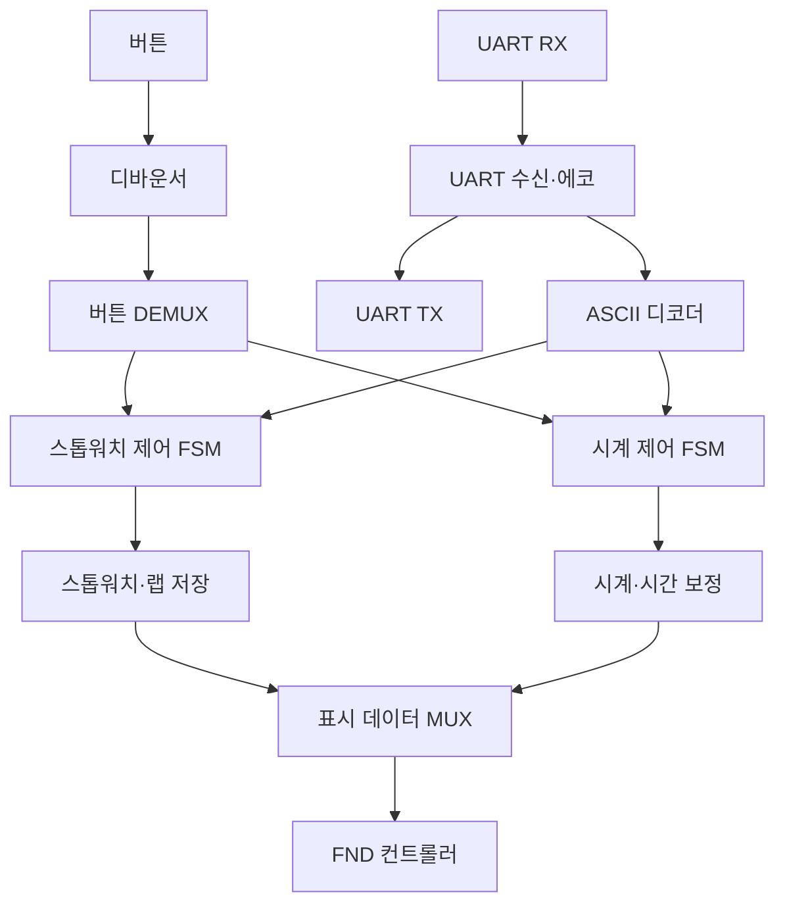

# CH1. UART 제어 디지털 시계·스톱워치 프로젝트 기술서

> 작성일: 2026-11-25. 현재 프로젝트의 RTL, 테스트벤치 및 Vivado 프로젝트 설정을 근거로 작성했다. 첨부한 기준설정 대화의 원칙에 따라 요구사항 → Design Specification → 설계 결정 → Verification List → 증거 및 판정을 연결했다. 당시 요구사항 문서와 시험 성적서가 없으므로 설계 기준은 현행 코드에서 재구성한 기준이며, 사전에 합의되었던 명세라고 단정하지 않는다. 검증 계획과 실제 검증 실적을 구분한다.

## 1. 개요

| 항목 | 내용 |
| --- | --- |
| 프로젝트명 | Basys-3 기반 UART 제어 디지털 시계·스톱워치 |
| 수행기간 | 확인 자료 없음. 작성일과 개발 수행기간은 구분 |
| 담당역할 | 문서화 대상은 RTL 설계, 통합 및 검증 분석. 개인별 담당 범위·기여도는 자료가 없어 확정하지 않음 |
| 수행목표 | 24시간 시계, 시간 보정, 양방향 스톱워치, 4개 랩 기록, 버튼·UART 입력 및 4자리 FND 출력을 통합 |
| 사용 기술 | Verilog HDL, FSM, Control Unit/Datapath 분리, 카운터, MUX/DEMUX, UART 16배 샘플링 tick, 버튼 디바운싱, FND 시분할 표시 |
| 개발 환경 | Vivado 2020.2 프로젝트, Basys-3, Artix-7 `xc7a35tcpg236-1` |
| 설계 최상위 | `rtl/top_watch_stopwatch.v`의 `top_watch_stopwatch` |
| 현재 확인 수준 | RTL 및 프로젝트 설정 정적 검토. 기능 시뮬레이션·합성·구현·보드 실측 합격 여부는 미확인 |

## 2. 세부수행내용

### 2.1. 프로젝트 개요

독립적인 시계와 스톱워치 데이터패스를 구성하고, 스위치로 버튼의 제어 대상과 FND 표시 대상을 선택한다. UART 수신 데이터는 ASCII 명령으로 해석하여 각 제어 FSM에 전달하며, 수신 바이트를 TX로 되돌려 보내는 에코 경로도 포함한다.

| 근거 파일 | 주요 역할 |
| --- | --- |
| `CH1_Digital_Clock_Design.xpr` | FPGA·보드 설정, 소스 등록, 최상위 및 시뮬레이션 설정 |
| `rtl/top_watch_stopwatch.v` | UART·버튼·제어부·데이터패스·표시부 통합 |
| `rtl/control_unit.v` | 시계 보정 및 스톱워치 상태 제어 |
| `rtl/watch.v` | 시계 카운터, 선택 필드 증감 |
| `rtl/stopwatch.v` | 100 Hz tick, 양방향 카운터, 랩 메모리 |
| `rtl/uart_loopbavk.v` | UART tick 생성, 수신·송신 FSM. 파일명은 현행 철자 그대로 표기 |
| `rtl/ascii_dec.v` | ASCII LUT 및 명령 펄스 생성 |
| `rtl/btn_debounce.v` | 4개 버튼의 연속 샘플 판정 및 상승 이벤트 생성 |
| `rtl/demux_1x2.v` | 선택된 기능으로 버튼 전달 |
| `rtl/top_fnd_controller.v` | 십진 자릿수 분리, 표시 선택, 스캔 및 세그먼트 디코딩 |
| `tb/tb_uart_digital_clock.v` | 제어부·ASCII 디코더의 초기화 중심 테스트벤치 3개 |

### 2.2. 프로젝트 목적

시간 계수라는 공통 기능을 시계와 스톱워치로 분리하여 제어 조건에 따라 재사용하고, 물리 버튼과 직렬 통신이라는 서로 다른 입력을 동일한 제어 이벤트로 통합하는 RTL 구조를 구현한다. 제한된 4자리 표시장치에서는 시·분과 초·1/100초를 선택 표시하고, 랩 기록으로 계수 중인 값과 저장된 값을 분리한다.

기술서의 목적은 구현 기능을 나열하는 데 그치지 않고, 각 구조의 선택 근거와 합격 기준을 명확히 하여 구현 여부와 검증 완료 여부를 판단할 수 있게 하는 것이다. 첨부 대화의 CPU·RTOS 사례 수치와 UVM 사용 이력은 이 프로젝트의 실적으로 전용하지 않았다.

### 2.3. 설계 기준설정 — Design Specification

아래 기준은 기본 파라미터를 대상으로 한다. **구현 관찰값**은 코드에서 직접 확인한 사실이며, **완료 기준**은 본 기술서에서 재구성한 검증 가능한 목표다.

| ID | 구분 | 설계 기준 및 완료 조건 | 근거 |
| --- | --- | --- | --- |
| DS-01 | 클럭·리셋 | 기준 클럭 100 MHz, 주기 10 ns. active-high 비동기 reset으로 지정 초기 상태 복귀 | 최상위 `SYS_CLK`, 각 순차 블록 |
| DS-02 | 시간 분해능 | 1,000,000클럭마다 1클럭 tick을 생성하여 10 ms 단위 계수 | `tick_gen_100hz` |
| DS-03 | 시계 | 1/100초 0~99, 초·분 0~59, 시 0~23. reset 후 12:00:00.00 | `watch_datapath`, `time_counter_watch` |
| DS-04 | 시간 보정 | NORMAL→HOUR→MIN→SEC→NORMAL 순환 및 역방향 선택. 선택한 필드 U/D 증감. 증가와 자연 tick은 감소보다 우선 | `watch_control_unit`, `time_counter_watch` |
| DS-05 | 스톱워치 | reset 후 정지·0. RUN/STOP으로 계수 허용, 정지 상태에서 CLEAR 및 방향 MODE 전환, 실행 중 LAP 허용 | `stopwatch_control_unit`, `time_counter` |
| DS-06 | 랩 저장 | 24비트 시간값 4개 저장, 유효 LED 표시. 미선택 시 실시간, 스위치 선택 시 저장값 표시 | `lap_memory`, `mux_5x1` |
| DS-07 | 버튼 | L/R/U/D 4개. 100 kHz 샘플 10회 연속 High로 눌림 판정 후 단일 이벤트 생성 | `btn_debounce` |
| DS-08 | UART | 기본 9600 bps, 데이터 8비트, LSB first, parity 없음, 1 stop bit에 해당하는 송신 구조. RX 완료 시 에코 및 명령 전달 | `uart_loopback`, RX/TX FSM |
| DS-09 | 명령 | `r/s/c/m/l/L/R/U/D` 9종 지원, 그 외 문자는 제어 출력 0 | `ascii_lut` |
| DS-10 | 입력·표시 선택 | `sw_sel[1]=0`: 스톱워치, `1`: 시계. `sw_sel[0]=0`: 초·1/100초, `1`: 시·분. LED는 선택 스위치 반영 | 최상위 배선, `top_fnd_controller` |
| DS-11 | FND | active-low 4자리 선택 및 8비트 세그먼트 출력. 1 kHz 스캔 상태 전진, 8상태 패턴 반복 | `clk_div`, `counter_8`, `bcd` |
| DS-12 | 구현 품질 | 최상위 정합성, 명시적 신호 선언, 비동기 입력·파생 클럭 검토, XDC 핀·클럭 제약, 제약된 경로의 setup/hold 만족 | 완료를 위한 추가 기준. 현행 자료만으로 충족 미확인 |

`msec`라는 신호명은 실제로 밀리초 숫자 0~999가 아니라 **10 ms 단위의 0~99 계수값**이다. 100 MHz는 설계 가정이며, 실제 배치·배선 후 100 MHz 동작을 입증하는 수치는 아니다. LUT·FF·전력 예산 및 실시간 시계의 장기 오차 허용치는 원자료에 없어 임의의 합격 수치를 추가하지 않는다.

#### 외부 조작 매핑

| 입력 | 동작 |
| --- | --- |
| 스톱워치 선택 상태의 L | 정지 중 시작, 실행 중 정지 |
| 스톱워치 선택 상태의 R / U / D | 각각 정지 중 초기화 / 정지 중 계수 방향 전환 / 실행 중 랩 이벤트 |
| 시계 선택 상태의 L / R | 보정 필드 역방향 / 정방향 선택 |
| 시계 선택 상태의 U / D | 선택 필드 증가 / 감소 |
| UART `r` / `s` / `c` | 스톱워치 실행 / 정지 / 초기화 요청 |
| UART `m` / `l` | 스톱워치 방향 전환 / 랩 요청 |
| UART `L` / `R` / `U` / `D` | 시계 보정 필드 이동 / 증감 |

버튼은 `sw_sel[1]`로 분기하지만 UART 명령은 표시 선택과 무관하게 해당 FSM으로 직접 전달된다. 화면에서 시계를 표시하는 동안에도 UART `r`로 스톱워치를 시작할 수 있는 연결이다. 버튼과 UART가 같은 이벤트를 동시에 요청하면 OR 결합하므로 하나의 요청으로 취급한다.

### 2.4. 설계 기준설정의 근거

| 설계 판단 | 수치·동작 도출 | 의미 및 제한 |
| --- | --- | --- |
| 시간 tick 분주 | 100,000,000 / 1,000,000 = 100 Hz | 10 ms 분해능 확보. 주석의 `1kHz`와 실제 분주값은 다름 |
| 카운터 폭 | ceil(log2(100))=7, ceil(log2(60))=6, ceil(log2(24))=5 | 7+6+6+5=24비트로 시간값 표현 |
| 랩 저장량 | 24비트 × 4 = 96비트 | 저장 데이터 용량이며 FPGA 전체 FF 사용량이나 BRAM 추론 결과는 아님 |
| UART 분주 | floor(100,000,000/(9600×16))=651 | 샘플 tick 간격 6.51 µs, 정상 비트 구간 104.16 µs |
| UART 양자화 오차 | 100,000,000/(651×16)≈9600.614 bps | 목표 대비 약 +0.0064%. 발진기 오차와 RX/TX 위상 영향은 별도 |
| UART 프레임 | 1 start+8 data+1 stop=10 bit | 9600 bps에서 약 1.0417 ms/byte. 버퍼 없는 연속 에코 처리 검증 필요 |
| 버튼 샘플링 | 100 MHz/(2×500)=100 kHz | 10샘플의 관찰 구간은 입력 위상에 따라 약 90~100 µs, 이후 이벤트 검출 지연 추가 |
| FND 스캔 | 100 MHz/(2×50,000)=1 kHz, 8상태 반복 | 스캔 상태는 1 ms, 전체 패턴 8 ms. 자리 선택 4상태는 두 번 반복 |

버튼 필터의 약 0.1 ms 조건이 실제 스위치 바운스를 충분히 제거하는지는 보드 실측으로 판단해야 한다. UART 분주만 `SYS_CLK`를 참조하고 시간·버튼·표시 분주는 100 MHz에 맞춘 상수를 사용하므로, `SYS_CLK` 변경만으로 시스템 전체 주파수가 자동 조정되는 구조는 아니다.

### 2.5. 설계 및 근거

#### 제어부와 데이터패스 분리

시계 FSM은 NORMAL/HOUR/MIN/SEC와 일시적인 UP/DOWN 상태로 필드 선택과 증감 이벤트를 분리한다. 스톱워치 FSM은 STOP/RUN과 CLEAR/MODE/LAP 상태로 요청을 해석한다. 상태와 출력은 레지스터로 관리하므로 입력과 출력이 항상 같은 클럭에 반영되는 것은 아니다. 정상 상태에서 단일 요청을 샘플한 뒤 다음 클럭에 제어 출력이 반영되는 경로가 있어, 검증에서는 상태·출력·카운터 소비 시점을 구분해야 한다.

STOP에서는 run→clear→mode, RUN에서는 stop→lap 순서로 우선순위가 정해진다. 시계 필드 선택 상태에서는 R→L→U→D 순서다. 이 우선순위를 예상 결과에 포함하여 동시 입력의 해석을 고정한다.

#### 시간 계수

시계와 스톱워치에 각각 100 Hz tick 생성기 및 100/60/60/24진 카운터를 배치한다. 시계는 계속 진행하며 보정 요청과 자연 계수 tick이 OR 결합되어 같은 사이클에 겹치면 한 번 증가한다. 자연 tick 또는 증가 요청이 있으면 감소 요청보다 우선한다. 보정 증가로 필드가 최대값에서 0으로 돌아갈 때 상위 필드로 carry가 전달되지만, 감소의 0→최대값에서는 borrow가 전달되지 않는다. 보정 시 시간 진행 정지나 대칭적인 borrow는 구현되어 있지 않다.

스톱워치는 `run_stop`으로 계수를 허용하고 `mode=0`에서 증가, `mode=1`에서 감소한다. 감소 모드에서 0인 채 실행하면 각 자리의 wrap 전달을 거쳐 최대 시간 방향으로 진행하는 순환 계수 구조이며, 0에서 자동 정지하는 타이머는 아니다. 하위 카운터의 carry가 등록되므로 상위 자리 변화는 다음 시스템 클럭에 전달된다.

#### 랩 메모리

빈 슬롯은 3→2→1→0 순서로 채운다. 가득 차면 신규 저장을 수행하지 않는다. 선택 스위치가 켜진 상태의 lap 이벤트는 선택 슬롯을 삭제하며, 여러 스위치가 켜지면 해당 슬롯을 모두 삭제한다. 여러 슬롯을 동시에 표시 선택하면 3→2→1→0 우선순위로 한 값을 표시한다. 일반 clear는 랩 메모리 입력에 연결되지 않아 랩 기록을 삭제하지 않으며 reset은 전체 기록을 지운다. 실시간 표시용 `data_stream`은 매 클럭 등록되어 한 클럭 지연된 값이다.

#### UART 및 ASCII 명령

RX/TX는 IDLE/START/DATA/STOP FSM을 사용한다. RX는 Low를 8개 샘플 tick 관찰해 시작을 인식한 뒤 16 tick 간격으로 데이터를 샘플한다. 이는 16배 tick을 이용한 단일 지점 샘플링이며 다수결 판정은 아니다. RX 완료 이벤트는 에코 송신과 ASCII 디코더에 동시에 전달된다. ASCII FSM은 완료 신호를 받은 다음 단계에서 LUT 값을 등록하므로 그때까지 `rx_data`가 유효해야 한다.

RX 입력 동기화 단계, stop bit High 유효성 검사, framing error 출력, FIFO 및 재전송은 확인되지 않는다. TX busy는 상위에서 사용하지 않으므로 연속 수신의 에코 무손실은 별도 검증 대상이다. DATA_WIDTH 파라미터가 있어도 종료 비교는 7로 고정되어 본 명세는 8비트 구성에 한정한다.

#### FND와 클럭 도메인

십진 자릿수는 나눗셈·나머지 연산으로 분리하고 MUX로 출력값을 선택한다. 8상태 중 0~3은 숫자, 4·5·7은 blank, 6은 dot용 패턴을 사용한다. 필드 선택 표시의 blank 제어는 `msec<50` 비교를 이용하므로 시계 정상 계수 가정에서 약 0.5초마다 반전된다.

주 계수·UART·FSM은 기본 클럭을 사용하지만 버튼 SIPO는 100 kHz, FND 스캔 카운터는 1 kHz 파생 클럭을 사용한다. 따라서 전체를 단일 클럭 설계로 기술할 수 없다. 파생 클럭 제약·전달 경로와 비동기 버튼/RX/스위치의 동기화 검토가 필요하다.

### 2.6. 검증 기준설정 — Verification List

**정적 확인**은 코드 구조 확인, **미실행**은 시험 계획만 정의한 상태다. 정적 확인을 동적 시험 Pass로 취급하지 않는다. 모든 시험은 기본 파라미터 및 100 MHz를 기준으로 하며, 실제 결과에는 입력 조건·기대값·관찰값·파형 또는 로그를 함께 남겨야 한다.

| Test ID | 연결 명세 | 검증 항목·합격 기준 | 방법·필요 증거 | 현재 판정 |
| --- | --- | --- | --- | --- |
| V-01 | DS-01 | reset 후 시계 12:00:00.00, 스톱워치 0·정지, 랩 LED 0, TX idle High | 각 상태·출력 파형 및 자동 비교 | 미실행 |
| V-02 | DS-02 | tick 간격 1,000,000클럭, 폭 1클럭 | 연속 tick의 클럭 수 측정 로그 | 미실행 |
| V-03 | DS-03 | 99→0, 59→0, 23→0 및 상위 carry가 각 한 번 발생 | 경계 전후 모든 필드 파형 | 미실행 |
| V-04 | DS-04 | L/R 필드 순환, U/D 증감, wrap·carry·우선순위가 명세와 일치 | 시계 FSM·카운터 비교 | 미실행 |
| V-05 | DS-05 | 시작·정지·재시작, 방향 전환, clear가 허용 상태에서만 반영 | 제어 출력과 시간값 비교 | 미실행 |
| V-06 | DS-06 | 랩 4개 저장·포화·선택·삭제·reset·clear 유지 정책 일치 | 슬롯값·LED·출력 비교 | 미실행 |
| V-07 | DS-07 | 10회 연속 High 충족 시 이벤트 1개, 유지 중 재발 없음, 해제 후 재입력 가능 | 합성 버튼 바운스 및 실물 파형 | 미실행 |
| V-08 | DS-08 | 9600 8N1 바이트 수신·에코 일치, 16 tick/정상 비트, rx_done 1클럭 | UART BFM 및 TX 재디코딩 | 미실행 |
| V-09 | DS-09 | 9개 ASCII가 정확한 one-hot 단일 펄스, 미지원 바이트는 0 | LUT 전수 256바이트·FSM 출력 비교 | LUT 매핑만 정적 확인 |
| V-10 | DS-10 | 4개 표시 모드, 버튼 분기, UART 독립 제어, LED 매핑 일치 | 최상위 통합 파형 | 배선만 정적 확인 |
| V-11 | DS-11 | 스캔 상태 1 ms, 패턴 8 ms, active-low 자리 및 숫자·dot·blank 일치 | 세그먼트 기대 패턴 비교·보드 관찰 | 미실행 |
| V-12 | DS-12 | 선택한 최상위의 미해결 모듈·포트 오류 없음, 암시적 net 및 미연결 입력 점검 완료 | compile/elaboration·lint 로그 | 정적 검토에서 문제 발견 |
| V-13 | DS-12 | 핀·클럭·파생 클럭 제약 검토, setup/hold 충족, 제약 누락 경로 검토 | XDC·STA·CDC·DRC 보고서 | 근거 자료 없음 |
| V-14 | DS-08 | 연속 프레임·비정상 stop·수신 중 reset의 처리와 한계 확인 | RX/TX·busy·에코 개수 비교 | 미실행, 일부 오류 검출 미구현 |

### 2.7. 검증 기준설정의 근거

기능별 시험은 DS-01~DS-11에서 기대 동작을 도출했다. 시간 계수는 정상 증가만 확인하면 carry 누락이나 중복을 찾기 어려우므로 최대값·최소값과 전파 시점까지 확인한다. FSM은 상태별 허용 명령과 동시 입력 우선순위를 검증하여 명령 수신 사실과 실제 실행 여부를 구분한다.

V-12~V-14는 동작 재현성과 인터페이스 안정성을 판단하기 위한 기준이다. 소스가 존재한다는 사실만으로 컴파일 성공을 주장할 수 없고, 파형이 정상이어도 핀·클럭 제약과 STA가 없으면 실제 보드의 100 MHz 동작을 보장할 수 없다. 오류 검출처럼 미구현된 기능은 정상 입력 명세와 구분하여 한계로 기록한다.

### 2.8. 검증 시나리오 및 근거

| 시나리오 | 자극·조건 | 예상 결과·확인점 | 근거 |
| --- | --- | --- | --- |
| S-01 초기화 | 동작 중 reset 인가 후 해제, 명령 입력은 0·RX는 High | 초기 시간·상태·LED 복귀. reset 해제의 동기화는 별도 검토 | 모든 후속 시험의 시작 상태 고정 |
| S-02 시간 경계 | 00.99→01.00, 59.99→다음 분, 23:59:59.99→00:00:00.00 관찰 | carry 파이프라인 지연 후 각 필드가 정확히 한 번 변함 | 연쇄 계수 및 일시적인 자리 불일치 점검 |
| S-03 보정 | R로 시·분·초 선택 후 U/D, L로 역순 이동. 자연 tick과 U/D 동시 인가 | 필드 선택·wrap·증가 우선. 자연 tick과 U는 한 번 증가, 0에서 D는 해당 필드 최대값 | OR 결합·우선순위·borrow 미전달 명세 확인 |
| S-04 스톱워치 | 실행→정지→대기→재시작→정지→clear, 정지 중 mode 전환 | 정지 중 값 유지, clear로 0, 방향에 따른 계수. RUN 중 clear/mode는 미수용 | 상태별 허용 명령 확인 |
| S-05 랩 | 서로 다른 시간에 4회 저장, 5번째 저장, 다중 슬롯 선택 및 lap 삭제 | 슬롯 3→0 저장, 포화 시 유지, 표시 우선순위 및 선택 슬롯 삭제 일치 | 저장 용량과 선택 정책 경계 확인 |
| S-06 버튼 바운스 | 샘플 에지 기준 9회 이하 High·Low 교차 후 연속 10회 High, 길게 유지 후 해제 | 연속 10회 조건 전 무이벤트, 충족 후 1이벤트. 실물 바운스에서도 중복 없는지 측정 | 펄스 폭만으로는 샘플 위상 조건을 보장할 수 없음 |
| S-07 ASCII | 각 유효 문자 및 미지원 문자, rx_done=0/1을 구분하여 입력 | 정확한 명령 펄스만 생성, 무효 문자 및 완료 없는 입력은 제어하지 않음 | LUT와 완료 이벤트 연동 확인 |
| S-08 UART | 00/FF/55/AA 및 명령 문자, 최소 간격 연속 프레임, 비정상 stop, 프레임 중 reset | 정상 바이트 및 에코 일치. 비정상 프레임 수용 여부·데이터 손실은 관찰 결과 기록 | 샘플 위상·busy 무시·오류 검출 부재 점검 |
| S-09 통합 | 표시 스위치 00/01/10/11, 표시와 다른 기능의 UART 명령, 버튼·UART 동시 요청 | 표시 데이터·버튼 대상·독립 UART 경로·우선순위 일치 | 모듈 단독 합격만으로 연결 정합성 보장 불가 |
| S-10 구현·실측 | XDC 및 파생 클럭 검토 후 구현, 버튼·FND·UART 계측 | STA/DRC 결과와 실제 신호 대응, 장기 시간 오차·실물 바운스 측정 | RTL 시뮬레이션 밖의 물리 조건 확인 |

경계값 가속 시험에서 내부 레지스터를 직접 설정하거나 분주값을 줄인다면 변경된 시험 조건을 명시해야 한다. 가속 시험으로 실제 100 MHz의 10 ms tick까지 검증했다고 주장해서는 안 된다. 본 작성 작업에서는 이러한 시험이나 소스 변경을 수행하지 않았다.

### 2.9. 검증 결과

본 기술서 작성 과정에서는 파일 읽기와 정적 검토만 수행했다. 추가 시험 파일·로그·시뮬레이션 산출물을 생성하지 않았으며, 도구 실행 결과나 보드 성공 이력을 임의로 보완하지 않았다.

| 확인 대상 | 실제 확인 결과 | 판정 범위 |
| --- | --- | --- |
| 프로젝트 설정 | Vivado 2020.2, Basys-3, FPGA 부품 및 설계 top 확인 | 설정 확인 |
| 통합 구조 | 시계·스톱워치·랩·UART·ASCII·버튼·FND 연결 존재 | 구현 구조 확인 |
| 테스트벤치 | 제어부 2개는 명령을 모두 0으로 유지한 채 약 120 ns 후 종료. ASCII TB는 `clk` 초기화 없음 | 유효 기능 자극·자동 판정 부족 |
| 시뮬레이션 설정 | simulation top이 TB가 아닌 `top_watch_stopwatch`, TB 파일에 `AutoDisabled=1` 존재 | 실행 대상 재확인 필요 |
| 제약·보고서 | 프로젝트의 `constrs_1`에 XDC 등록 없음. 현재 폴더에 XDC·STA·자원 보고서 없음 | 타이밍·핀 배치·자원 충족 미확인 |
| 파형 | `waveform` 폴더에 검토할 파일 없음 | 파형 근거 없음 |
| 정적 문제 | 암시적 carry net, 구형 wrapper 포트 불일치, 미연결 입력, CDC 검토 필요 항목 확인 | 수정 및 재검증 필요 |

120 ns는 10 ms 시간 tick은 물론 UART 한 프레임도 관찰할 수 없는 길이다. assertion, scoreboard, 기대값 비교 및 coverage 수치도 확인되지 않아, 현재 자료로 Verification List의 전체 또는 일부 기능 시험이 Pass했다고 판정하지 않는다.

### 2.10. 문제해결 — Troubleshooting

아래는 현재 파일의 **문제 → 원인 → 권고 조치 → 확인 결과 → 인사이트**다. 과거에 수정·재시험을 완료했다는 기록은 없으며, 요청 범위에 따라 조치는 제안만 하고 RTL·설정은 변경하지 않았다.

| 문제 | 원인 | 권고 조치 | 현재 결과 | 인사이트 |
| --- | --- | --- | --- | --- |
| 스톱워치 초 carry 신호가 명시 선언되지 않음 | `stopwatch_datapath`에서 `w_tick_msec` 사용, wire 목록에는 없음 | 해당 wire 선언 및 lint·carry 경계 시험 | 암시적 net으로 처리될 수 있는 코드 확인. 컴파일 실패로 단정하지 않음 | 명시 선언과 lint로 오타·폭 문제 조기 검출 |
| 보조 top의 포트 정합성 불일치 | `top_stopwatch`가 현행 CU에 없는 `i_run_stop` 사용. `top_watch`는 현행 datapath에 없는 `i_btn_U/D` 사용 | 보조 wrapper의 사용 여부 정리 후 인터페이스 갱신·개별 elaboration | 소스 수준 불일치 확인. 활성 top에서의 오류 여부는 elaboration 필요 | 재사용 인터페이스 변경 시 모든 호출부 추적 |
| 보조 FND 모듈 해석 불확실 | 보조 top에서 `fnd_controller`, `watch_fnd_controller` 참조, 현재 RTL에는 해당 정의 없음 | 사용 wrapper별 의존 모듈 명세 및 정합화 | 활성 통합 top은 정의된 `top_fnd_controller` 사용 | 비활성 경로 문제와 활성 계층 문제 구분 |
| 시계 하위 보정 입력 미연결 | 1/100초 카운터의 `i_count_up/down`을 빈 연결로 둠 | 미사용 입력 0 고정 및 X/Z 전파 점검 | 미연결 사실 확인, 동적 영향 미측정 | 상수 입력도 인터페이스 계약의 일부 |
| carry가 모든 분기에서 명시 해제되지 않음 | 카운터의 비경계 증가·감소 분기에서 tick 레지스터 기존값 유지 | 매 사이클 기본 0 후 경계에서만 1로 설정하고 연속 tick 시험 | 통상 tick 사이에는 해제되나 연속 입력 시 유지 가능성 존재 | 펄스 폭은 정상 간격뿐 아니라 인접 사이클에서도 검증 |
| TB가 기능 검증 증거를 만들지 못함 | 자극·기대값 비교 부재, ASCII TB `clk` 미초기화, simulation top 설정 불일치 | TB clock 초기화, 기능별 자극·checker, 올바른 simulation top 지정 | 검증 미완료 상태 확인 | TB 존재와 검증 완료를 구별 |
| 입력 안정성·클럭 제약 근거 부족 | RX 직접 사용, 버튼 파생 클럭 결과를 기본 클럭에서 관찰, 스위치 직접 선택 | 입력 동기화, clock enable 대안, 파생 클럭·CDC·reset 해제 검토 | 검토 필요 구조 확인, metastability 발생을 실증한 것은 아님 | 기능 정상 파형과 물리적 안정성은 별도 검증 |
| 에코 연속 처리 및 비정상 프레임 대응 불명확 | FIFO 없음, TX busy 미사용, stop bit 검증 없음 | 연속 프레임·오류 시험 후 요구사항에 따라 버퍼·오류 상태 추가 | 정상 통신 가능 구조만 확인, 무손실·오류 복구 미입증 | 지원 범위를 정상 입력과 오류 조건으로 분리 |

### 2.11. 결론

**설계 — Design Specification을 만족했는가?**

100 MHz를 기준으로 하는 시간 계수, 시계 보정, 스톱워치 제어, 랩 저장, UART 명령 및 FND 표시의 통합 구조가 RTL에 존재한다. 시간 분해능·카운터 폭·UART 분주·메모리 용량은 코드에서 정량적으로 도출할 수 있다. 다만 기능 동작을 전부 확인한 것은 아니며 포트 정합성, 암시적 net, 입력 동기화 및 제약 자료 부재가 남아 있어 **전체 명세 충족은 미확인**이다.

**검증 — Verification List를 만족했는가?**

요구사항별 검증 항목·시나리오·합격 기준은 본 문서에 정의했으나, 현재 TB와 결과 자료로는 해당 목록의 완료를 입증할 수 없다. 따라서 **검증 완료 또는 전체 Pass로 판정할 수 없다.** 다음 완료 판단에는 정합성 확인, 자동 비교 기반 기능 검증, 제약·STA 검토 및 보드 실측 증거가 필요하다.

이 프로젝트에서 확인한 핵심 설계 가치는 제어부와 데이터패스 분리, 다중 입력의 공통 이벤트화, 제한된 표시장치의 시분할 활용이다. 기술적 성과를 최종 확정하려면 이 구조가 사전에 정의한 조건에서 올바르게 동작한다는 시험 결과를 각 명세 ID와 연결해 제시해야 한다.
